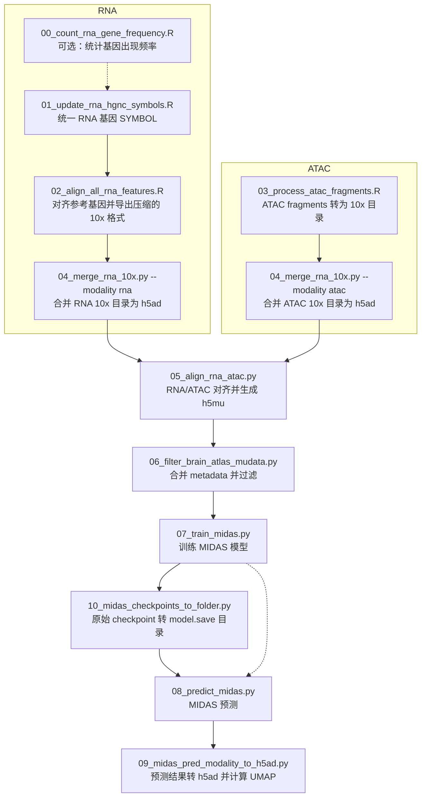

# code/scripts 脚本流程说明

本文档简要说明 `code/scripts/` 中主要脚本的作用和推荐执行顺序。

## 总体顺序



## 推荐执行步骤

| 顺序 | 脚本                                  | 作用                                                                                                                                                                                                   | 主要输入                                                                                                                                     | 主要输出 / 下游依赖                                                                                                                                                      |
| ---: | ------------------------------------- | ------------------------------------------------------------------------------------------------------------------------------------------------------------------------------------------------------ | -------------------------------------------------------------------------------------------------------------------------------------------- | ------------------------------------------------------------------------------------------------------------------------------------------------------------------------ |
|    0 | `00_count_rna_gene_frequency.R`     | 可选 QC：统计每个基因在多少个 RNA RDS 文件中出现，用于检查基因集合覆盖情况。                                                                                                                           | `parameters/rna_path.txt` 中的 `rna.rds`                                                                                                 | `logs/rna_gene_frequency/` 下的频率表和失败记录；不直接进入主流程。                                                                                                    |
|    1 | `01_update_rna_hgnc_symbols.R`      | 批量更新 RNA Seurat RDS 的基因名到 HGNC SYMBOL，并合并重复基因。默认 dry-run，需加`--run` 才覆盖保存。                                                                                               | `parameters/rna_path.txt`、RNA Seurat RDS                                                                                                  | 更新后的原始`rna.rds`；日志在 `logs/update_rna_hgnc_symbols/`。                                                                                                      |
|    2 | `02_align_all_rna_features.R`       | 将每个 RNA RDS 按参考基因表对齐，导出 10x matrix 目录，并自动将`matrix.mtx` 压缩为 `matrix.mtx.gz`。默认 dry-run，需加 `--run`。                                                                 | 更新后的`rna.rds`、`parameters/genes_20260527.csv`、`code/src/r/utils.r`                                                               | 默认写入`data/processed/Atlas_20260721/rna/{DONOR_ID}/`：`matrix.mtx.gz`、`barcodes.tsv.gz`、`features.tsv.gz`、`rna_ref_presence.csv.gz`。                    |
|    3 | `03_process_atac_fragments.R`       | 将 ATAC fragment 文件按参考 peaks 做 FeatureMatrix 计数，经 counts、TSS enrichment、nucleosome signal 和 FRiP 阈值过滤后导出 10x 目录。默认 dry-run，需加`--run`。                                   | `parameters/fragments_path.txt`（`DONOR_ID`、`PATH`）、`parameters/reference_peaks.bed`                                              | 默认写入`data/processed/Atlas_20260528/atac/{DONOR_ID}/`：`matrix.mtx.gz`、`barcodes.tsv.gz`、`features.tsv.gz`；加 `--save-qc` 时另写 `qc_metrics.tsv.gz`。 |
|    4 | `04_merge_rna_10x.py`               | 合并多个 donor 的 10x 目录为 AnnData；应分别以`--modality rna` 和 `--modality atac` 运行。RNA 模式会把 `rna_ref_presence.csv.gz` 读入 `uns['mask_<DONOR_ID>']`。默认 dry-run，需加 `--run`。 | 对应模态的 donor 10x 子目录（`--input-dir`）                                                                                               | 每次运行产生一个`.h5ad`；运行 ATAC 模式时应通过 `--output` 指定独立的 ATAC 输出路径，避免使用默认 RNA 文件名。                                                       |
|    5 | `05_align_rna_atac.py`              | 读取 RNA 和 ATAC`.h5ad`，按 `obs['batch']` 对齐：共同 batch 保留交集细胞，单模态 batch 保留全部细胞，写为 MuData。                                                                                 | RNA`.h5ad`、ATAC `.h5ad`                                                                                                                 | 对齐后的`.h5mu`。                                                                                                                                                      |
|    6 | `06_filter_brain_atlas_mudata.py`   | 将样本 metadata 合并到`mdata.obs`，移除 `Enrollment == 'N'` 的细胞，过滤小 batch（`--min-cells-per-batch`），清理过期 RNA mask。                                                                 | 对齐后的`.h5mu`、`parameters/2026-05-24_brain_atlas.csv`                                                                                 | 过滤后的`.h5mu`，供 MIDAS 使用。                                                                                                                                       |
|    7 | `07_train_midas.py`                 | 读取过滤后的 MuData，配置并训练 MIDAS 模型（数据路径、feature dimensions 和训练参数写在脚本内部，非 CLI）。                                                                                            | 过滤后的`.h5mu`、scmidas/Lightning 环境                                                                                                    | 原始`.pt` checkpoint、TensorBoard 日志。                                                                                                                               |
|   7a | `10_midas_checkpoints_to_folder.py` | 当待预测模型只有训练生成的原始`.pt` checkpoint 时，将其转换为 `model.save(...)` 格式目录；若已有该格式目录，可跳过。尽管文件编号为 10，此步骤应在预测前执行。                                      | 原始`.h5mu`、checkpoint `.pt` 文件                                                                                                       | 含`model.pt` 和 `setup.json` 的模型目录。                                                                                                                            |
|    8 | `08_predict_midas.py`               | 加载`model.save(...)` 格式的 MIDAS 模型，对 MuData 做预测，流式写出 joint latent 和 RNA/ATAC batch-corrected 矩阵 shard；默认格式为 `.npy`。                                                       | `.h5mu`、模型目录（`model.pt` + `setup.json`）、feature dimensions TOML                                                                | `--out-dir` 下按 batch 组织的预测 shard 及 `predict_manifest.json`。                                                                                                 |
|    9 | `09_midas_pred_modality_to_h5ad.py` | 将预测 shard 合并为指定模态的 AnnData，写入 batch-corrected`X`、`X_midas` 和 `X_midas_u`，并计算 MIDAS neighbors、Leiden 聚类及 UMAP。                                                           | `--pred-dir`、`--modality`，以及 `--dim-c` 或可推断该值的 `--model-dir`；推荐提供原始 `.h5mu`（`--mdata`）以保留细胞名和特征名。 | 单模态`.h5ad`（RNA 或 ATAC）及同名的 `_midas_umap.png`。                                                                                                             |

## 关键依赖关系

1. `01_update_rna_hgnc_symbols.R` 应在 RNA 特征对齐前运行，否则后续参考基因对齐会基于未统一的旧 SYMBOL。
2. `02_align_all_rna_features.R` 产生的 `rna_ref_presence.csv.gz` 会在 `04_merge_rna_10x.py --modality rna` 中作为 donor-specific mask 读入，因此不要删除。
3. RNA 路径：`02_align_all_rna_features.R` 已自动生成 `matrix.mtx.gz`，可直接被 `04_merge_rna_10x.py --modality rna` 使用，不再需要单独的 matrix 压缩步骤。
4. ATAC 路径：`03_process_atac_fragments.R` 直接生成 `matrix.mtx.gz`，可直接被 `04_merge_rna_10x.py --modality atac` 使用。RNA 与 ATAC 合并需分别运行，并写到不同的 `.h5ad`。
5. `05_align_rna_atac.py` 要求 RNA 和 ATAC AnnData 都有 `obs['batch']`，其中 batch 应对应 donor/sample ID。
6. `06_filter_brain_atlas_mudata.py` 要求 `mdata.obs['batch']` 能在 metadata 的 `DONOR_ID` 列中匹配。
7. `07_train_midas.py` 的参数写在脚本内部；运行前需确认 `DATA_PATH` 指向第 6 步得到的最终 `.h5mu`，并确认 `FEAT_DIMS` 与 RNA/ATAC 的实际特征数一致。
8. `08_predict_midas.py` 只接受 `model.save(...)` 格式的模型目录。如果训练结果仅有原始 checkpoint，先运行 `10_midas_checkpoints_to_folder.py`。
9. `08_predict_midas.py` 使用的 feature dimensions TOML 必须与训练设置及待预测 MuData 的特征维度一致。
10. `09_midas_pred_modality_to_h5ad.py` 每次只导出一个模态；RNA 和 ATAC 需要分别运行。

## 简洁使用示例

以下命令均从项目根目录运行。建议先用 `--limit 2` 或 `--dry-run` 检查输入，再执行完整流程。

```bash
# 0. 可选：检查 RNA 基因覆盖情况
Rscript code/scripts/00_count_rna_gene_frequency.R --limit 2

# 1–3. 准备各 donor 的 RNA/ATAC 10x 目录
Rscript code/scripts/01_update_rna_hgnc_symbols.R --limit 2       # dry-run
Rscript code/scripts/01_update_rna_hgnc_symbols.R --run           # 覆盖原 rna.rds

Rscript code/scripts/02_align_all_rna_features.R --limit 2         # dry-run
Rscript code/scripts/02_align_all_rna_features.R --run \
  --outputdir data/processed/Atlas_20260721/rna

Rscript code/scripts/03_process_atac_fragments.R --limit 2         # dry-run
Rscript code/scripts/03_process_atac_fragments.R --run --save-qc \
  --output-dir data/processed/Atlas_20260721/atac

# 4. 分别合并 RNA 和 ATAC
python code/scripts/04_merge_rna_10x.py --modality rna \
  --input-dir data/processed/Atlas_20260721/rna \
  --output data/processed/Atlas_20260721/merged_rna.h5ad --run

python code/scripts/04_merge_rna_10x.py --modality atac \
  --input-dir data/processed/Atlas_20260721/atac \
  --output data/processed/Atlas_20260721/merged_atac.h5ad --run

# 5–6. 对齐模态、合并 metadata 并过滤
python code/scripts/05_align_rna_atac.py \
  --rna data/processed/Atlas_20260721/merged_rna.h5ad \
  --atac data/processed/Atlas_20260721/merged_atac.h5ad \
  --output data/processed/Atlas_20260721/aligned.h5mu

python code/scripts/06_filter_brain_atlas_mudata.py \
  --input data/processed/Atlas_20260721/aligned.h5mu \
  --metadata parameters/2026-05-24_brain_atlas.csv \
  --output data/processed/Atlas_20260721/aligned_filtered.h5mu \
  --min-cells-per-batch 1000
```

训练前，在 `07_train_midas.py` 中确认 `TASK`、`DATA_PATH`、`SAVE_MODEL_PATH`、GPU 参数和 feature dimensions，然后运行：

```bash
python code/scripts/07_train_midas.py
```

若训练结果只有原始 `.pt` checkpoint，先转换模型目录，再预测并分别导出两个模态。下例中的 `MODEL_DIR` 应替换为转换后实际包含 `model.pt` 和 `setup.json` 的目录。

```bash
python code/scripts/10_midas_checkpoints_to_folder.py \
  --mdata data/processed/Atlas_20260721/aligned_filtered.h5mu \
  --checkpoint-dir data/processed/Atlas_20260721/saved_models/Atlas_20260721_imm \
  --checkpoint data/processed/Atlas_20260721/saved_models/Atlas_20260721_imm/model_epoch600_20260810-003029.pt \
  --feat-dims parameters/20260721-feat_dim.toml

MODEL_DIR=data/processed/Atlas_20260721/saved_models/Atlas_20260721_imm/model_epoch4000_YYYYMMDD-HHMMSS
PRED_DIR=data/processed/Atlas_20260721/midas_prediction
MDATA=data/processed/Atlas_20260721/aligned_filtered.h5mu

python code/scripts/08_predict_midas.py \
  --mdata "$MDATA" --model-dir "$MODEL_DIR" \
  --feat-dims parameters/20260721-feat_dim.toml \
  --out-dir "$PRED_DIR"

python code/scripts/09_midas_pred_modality_to_h5ad.py \
  --pred-dir "$PRED_DIR" --modality rna \
  --mdata "$MDATA" --model-dir "$MODEL_DIR" \
  --output data/processed/Atlas_20260721/midas_rna.h5ad

python code/scripts/09_midas_pred_modality_to_h5ad.py \
  --pred-dir "$PRED_DIR" --modality atac \
  --mdata "$MDATA" --model-dir "$MODEL_DIR" \
  --output data/processed/Atlas_20260721/midas_atac.h5ad
```
